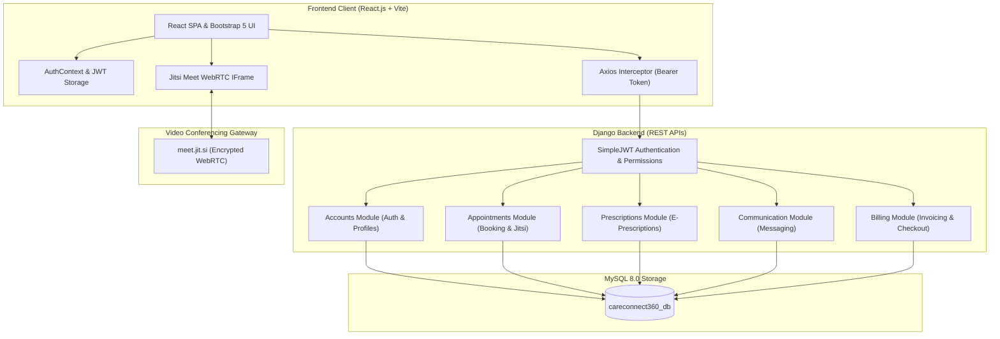

# System Architecture
## CareConnect360 – VirtualCare Telemedicine Platform

### Architectural Principles:
1. **Separation of Concerns:** Independent Django apps (`accounts`, `appointments`, `prescriptions`, `communication`, `billing`) handle distinct domain boundaries.
2. **Stateless API Services:** Django REST Framework endpoints utilize stateless JWT Bearer authorization.
3. **Decoupled Video Layer:** Video streams do not choke application bandwidth; authenticated tokens pass encrypted room identifiers to the Jitsi WebRTC gateway.
